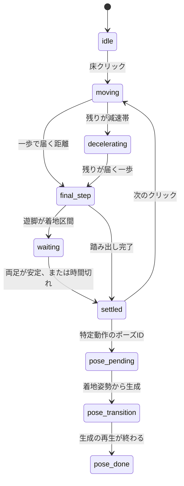

# 歩行・停止・Idle の再設計

日付: 2026-11-01

この文書は、短距離の足滑りと停止後の足幅変化について、コード上で確認できた原因と、それに対する制御の置き換えを残す。RTX 4090 上の見た目は未確認である。数値は、膝を曲げた合成骨格での制御シミュレーションであり、MotionBricks の推論結果ではない。

## 原因

### 短距離で足が滑る

SOMA の線形移動は、Walk の目標を `default_speed`（2.3 m/s）に置いている（`app/runtime/soma/presets.py` の `LINEAR_LOCOMOTION`）。入力の長さは `MovementControl._read_input` で速度になる。

```text
input_speed = max(default_speed * movement_length, minimum_speed)
```

以前の `click_planner` は、目的地が近いほど `movement` の長さを 0.12 まで下げ、さらに `minimum_speed` を 0 にしていた。0.12 × 2.3 m/s は約 0.28 m/s で、ブレンドは Idle 目標に近くなる。姿勢はほとんど歩かず、ルートだけがその速度で進む。これが短距離の滑りである。最低速度を上げて同じ低速再生を続けるのではなく、Walk ブレンドを使う距離と、一歩で進む距離を分けた。

### 停止後に足幅が変わる

`LocomotionState.update` は `input_speed <= 0` の瞬間に `transition_to_idle` を呼ぶ。`IdleState.enter` は `generate_clip_transition` で、待機クリップ（`idle_loop_001` など）の開始姿勢へ向かう動作を生成する。このクリップの足幅は、歩行の着地姿勢と違う。

以前の `GroundedIdle` は、フェーズが `idle` になったあとの表示を固定していた。公式遷移が始まったあとに戻す処理であり、速度や公式状態の条件でその固定を捨てる経路も残っていた。今回は、着地が済むまで入力を 0 にせず、着地した同一フレームを `settled` として保持する。`hold_stance` の通常移動では `character.step` を止めるので、待機クリップへの生成は走らない。

## 姿勢の所有者

| 状態 | 脚と腰 | 上半身 | MotionBricks |
| --- | --- | --- | --- |
| 起動直後の idle | 公式の待機クリップ | 同じクリップ | `step`（入力なし） |
| moving / decelerating | 線形歩行。入力の長さは 1 | 同じ生成 + スライダー | `step` |
| final_step / waiting | 踏み出し。支持足は固定、遊脚だけ上げる | 開始フレームの上半身 | `step` しない |
| settled | 着地フレームを次の移動まで保持 | 胸と背骨の呼吸だけ | `step` しない |
| 特定動作の到着 | 着地フレームから目標姿勢へ生成 | その生成 | 生成の再生 |

スライダー（歩行中の 9.5° を含む）は `live` のときだけ掛ける。`settled` のスナップショットには、そのフレームで既に掛かった補正が入っている。停止中に重ね掛けしない。

減速中も入力は 1 のままである。ここで速度だけ下げると、再び Idle ブレンドへ寄る。減速とは「この先は新しい長距離歩行を始めず、残りの一歩で終わる」という意味である。

公式状態名は、`settled` のあいだも Locomotion のままになる。Idle へ入ると待機クリップが生成されるため、意図的に遷移させていない。表示姿勢は `current_pose` に書き戻した着地姿勢と一致する。状態の名前と「止まって見えること」は一致しない。これは残っている制約である。

特定動作では、到着ポーズの再生を公式の Idle 状態に残す必要がある。その `enter` が待機クリップを生成するので、公開する前に着地姿勢へ戻し、到着ポーズの生成で置き換える。待機クリップの足は画面に出ない。通常の床クリックは d3-mini を呼ばない。

## 状態遷移



`waiting` は無期限に待たない。接地値がクリップ再生で 0 のときは「浮いている」ではなく「使えない」とし、高さと水平速度で判断する。0.75 秒を超えたらその旨をログして着地扱いにする。

## 距離の分け方

初期の境界（0.15 / 0.6 / 1.2 m）は、そのフレームの脚が届く水平距離で狭める。合成骨格では届く一歩が約 0.28 m だった。実機の SOMA 姿勢では、その場の脚の長さから測り直す。方式は移動要求の開始時に一度だけ選び、境界をまたいでも途中で切り替えない。

0.08 m 未満は動かない。それ以上で線形歩行に入らない距離は、支持足を固定した踏み出しで進む。腰だけを目的地へ運ぶフレームは作らない。届かない目標は足首を伸ばす前に、腰の移動を短くする。前後の開きが 0.26 m を超えるときだけ、遊脚を上げて 10 cm の前後差まで揃える。横幅は変えない。

## 計測

ブラウザの「歩行デバッグ」または D キーで、接地を緑、遊脚を赤、滑りが 5 mm を超えた足の軌跡を出す。ログは `GET /gait-log` と `GET /gait-log.csv`。

`docs/samples/short-step-simulation.json` は合成骨格の制御ログである。0.30 m の結果は次のとおり。

| 項目 | シミュレーション値 | 初期目標 |
| --- | --- | --- |
| 到着誤差 | 1.85 cm | 8 cm 以内 |
| 接地中の最大滑り | 0.32 cm | 2 cm 以内 |
| 横幅の変化 | 0 cm | 踏み直しなしなら 2 cm 以内 |

4 m の歩行区間は、モデルの代わりにルートを 2.3 m/s で進めただけなので、その区間の足滑りは測っていない。最後の一歩に入ったあとの到着誤差は、この代替では 0 cm だった。推論中の足滑りは RTX 4090 で取り直す必要がある。

0.30 m の 55 フレームは CPython で約 163 ms（1 フレームあたり約 3 ms）だった。GPU 推論のフレーム時間は、今回測っていない。踏み出しと停止保持のあいだは `character.step` を呼ばない。

## テスト

自動テストは 2026-11-01 に通過した。

- `python -m unittest discover -s tests -v` : 56 件成功
- `node --test web/src/poseOwner.test.js web/src/groundedIdle.test.js` : 成功

見ていないもの: RTX 4090 上のロゼの歩行、停止、Idle、再歩行、椅子への着席。合格とは書かない。

## 変更したファイル

- `backend/foot_plant.py` : 4 点の接地と、接地中だけの滑り
- `backend/gait_plan.py` : 距離と、入力 0 か 1 かの選択
- `backend/step_cycle.py` : 支持足を固定する一歩
- `backend/locomotion_cycle.py` : 移動から着地までの状態
- `backend/gait_log.py` : JSON / CSV
- `backend/click_planner.py` : 中間の入力強度を返さない
- `backend/engine.py` : 公式の最低速度を戻し、状態ごとに推論するか書き戻すかを分ける
- `backend/server.py` : 通常クリックでは到着ポーズを選ばない。ログの取得
- `web/src/poseOwner.js` : 停止姿勢を速度や遅延フレームで捨てない
- `web/src/gaitDebug.js` : 接地と軌跡
- `web/src/main.js` : 描画の所有者を `settled` に合わせる
- `web/index.html` : デバッグとログの操作
- `tests/test_gait.py` `tests/test_click_planner.py` `web/src/poseOwner.test.js`

## 残っていること

1. RTX 4090 で、20 cm から 10 m、歩行中の別クリック、停止直後の再歩行、30 秒の Idle、椅子への着席を目で確認する。
2. 公式状態名が Locomotion のまま止まる。名前を変えるには、待機クリップを生成しない停止状態が公式側に要る。
3. 最後の一歩は手続き的なので、MotionBricks の歩行の見た目とは違い得る。
4. 歩行の最初のフレームは、Idle ブレンドを避けるために Walk 速度へ置く。加速の入りは公式のスプリングより急になる。
5. 到着ポーズは、内部で一度だけ Idle へ入ってから上書きする。失敗した場合の姿勢は着地のまま残す。
