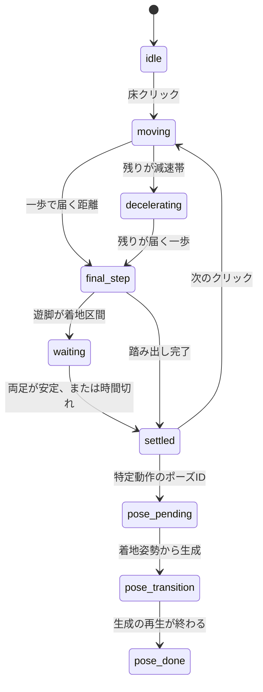

# 歩行・停止・Idle の再設計

日付: 2026-11-01

この文書は、短距離の足滑りと停止後の足幅変化について、コード上で確認できた原因と、それに対する制御の置き換えを残す。RTX 4090 上の見た目は未確認である。数値は、膝を曲げた合成骨格での制御シミュレーションであり、MotionBricks の推論結果ではない。

## 原因

### 短距離で足が滑る

SOMA の線形移動は、Walk の目標を `default_speed`（2.3 m/s）に置いている（`app/runtime/soma/presets.py` の `LINEAR_LOCOMOTION`）。入力の長さは `MovementControl._read_input` で速度になる。

```text
input_speed = max(default_speed * movement_length, minimum_speed)
```

以前の `click_planner` は、目的地が近いほど `movement` の長さを 0.12 まで下げ、さらに `minimum_speed` を 0 にしていた。0.12 × 2.3 m/s は約 0.28 m/s で、ブレンドは Idle 目標に近くなる。姿勢はほとんど歩かず、ルートだけがその速度で進む。これが短距離の滑りである。最低速度を上げて同じ低速再生を続けるのではなく、Walk ブレンドを使う距離と、一歩で進む距離を分けた。

### 停止後に足幅が変わる

`LocomotionState.update` は `input_speed <= 0` の瞬間に `transition_to_idle` を呼ぶ。`IdleState.enter` は `generate_clip_transition` で、待機クリップ（`idle_loop_001` など）の開始姿勢へ向かう動作を生成する。このクリップの足幅は、歩行の着地姿勢と違う。

以前の `GroundedIdle` は、フェーズが `idle` になったあとの表示を固定していた。公式遷移が始まったあとに戻す処理であり、速度や公式状態の条件でその固定を捨てる経路も残っていた。今回は、着地が済むまで入力を 0 にせず、着地した同一フレームを `settled` として保持する。`hold_stance` の通常移動では `character.step` を止めるので、待機クリップへの生成は走らない。

## 姿勢の所有者

| 状態 | 脚と腰 | 上半身 | MotionBricks |
| --- | --- | --- | --- |
| 起動直後の idle | 公式の待機クリップ | 同じクリップ | `step`（入力なし） |
| moving / decelerating | 線形歩行。入力の長さは 1 | 同じ生成 + スライダー | `step` |
| final_step / waiting | 踏み出し。支持足は固定、遊脚だけ上げる | 開始フレームの上半身 | `step` しない |
| settled | 着地フレームを次の移動まで保持 | 胸と背骨の呼吸だけ | `step` しない |
| 特定動作の到着 | 着地フレームから目標姿勢へ生成 | その生成 | 生成の再生 |

スライダー（歩行中の 9.5° を含む）は `live` のときだけ掛ける。`settled` のスナップショットには、そのフレームで既に掛かった補正が入っている。停止中に重ね掛けしない。

減速中も入力は 1 のままである。ここで速度だけ下げると、再び Idle ブレンドへ寄る。減速とは「この先は新しい長距離歩行を始めず、残りの一歩で終わる」という意味である。

公式状態名は、`settled` のあいだも Locomotion のままになる。Idle へ入ると待機クリップが生成されるため、意図的に遷移させていない。表示姿勢は `current_pose` に書き戻した着地姿勢と一致する。状態の名前と「止まって見えること」は一致しない。これは残っている制約である。

特定動作では、到着ポーズの再生を公式の Idle 状態に残す必要がある。その `enter` が待機クリップを生成するので、公開する前に着地姿勢へ戻し、到着ポーズの生成で置き換える。待機クリップの足は画面に出ない。通常の床クリックは d3-mini を呼ばない。

## 状態遷移



`waiting` は無期限に待たない。接地値がクリップ再生で 0 のときは「浮いている」ではなく「使えない」とし、高さと水平速度で判断する。0.75 秒を超えたらその旨をログして着地扱いにする。

## 距離の分け方

初期の境界（0.15 / 0.6 / 1.2 m）は、そのフレームの脚が届く水平距離で狭める。合成骨格では届く一歩が約 0.28 m だった。実機の SOMA 姿勢では、その場の脚の長さから測り直す。方式は移動要求の開始時に一度だけ選び、境界をまたいでも途中で切り替えない。

0.08 m 未満は動かない。それ以上で線形歩行に入らない距離は、支持足を固定した踏み出しで進む。腰だけを目的地へ運ぶフレームは作らない。届かない目標は足首を伸ばす前に、腰の移動を短くする。前後の開きが 0.26 m を超えるときだけ、遊脚を上げて 10 cm の前後差まで揃える。横幅は変えない。

## 計測

ブラウザの「歩行デバッグ」または D キーで、接地を緑、遊脚を赤、滑りが 5 mm を超えた足の軌跡を出す。ログは `GET /gait-log` と `GET /gait-log.csv`。

`docs/samples/short-step-simulation.json` は合成骨格の制御ログである。0.30 m の結果は次のとおり。

| 項目 | シミュレーション値 | 初期目標 |
| --- | --- | --- |
| 到着誤差 | 1.85 cm | 8 cm 以内 |
| 接地中の最大滑り | 0.32 cm | 2 cm 以内 |
| 横幅の変化 | 0 cm | 踏み直しなしなら 2 cm 以内 |

4 m の歩行区間は、モデルの代わりにルートを 2.3 m/s で進めただけなので、その区間の足滑りは測っていない。最後の一歩に入ったあとの到着誤差は、この代替では 0 cm だった。推論中の足滑りは RTX 4090 で取り直す必要がある。

0.30 m の 55 フレームは CPython で約 163 ms（1 フレームあたり約 3 ms）だった。GPU 推論のフレーム時間は、今回測っていない。踏み出しと停止保持のあいだは `character.step` を呼ばない。

## テスト

自動テストは 2026-11-01 に通過した。

- `python -m unittest discover -s tests -v` : 56 件成功
- `node --test web/src/poseOwner.test.js web/src/groundedIdle.test.js` : 成功

見ていないもの: RTX 4090 上のロゼの歩行、停止、Idle、再歩行、椅子への着席。合格とは書かない。

## 変更したファイル

- `backend/foot_plant.py` : 4 点の接地と、接地中だけの滑り
- `backend/gait_plan.py` : 距離と、入力 0 か 1 かの選択
- `backend/step_cycle.py` : 支持足を固定する一歩
- `backend/locomotion_cycle.py` : 移動から着地までの状態
- `backend/gait_log.py` : JSON / CSV
- `backend/click_planner.py` : 中間の入力強度を返さない
- `backend/engine.py` : 公式の最低速度を戻し、状態ごとに推論するか書き戻すかを分ける
- `backend/server.py` : 通常クリックでは到着ポーズを選ばない。ログの取得
- `web/src/poseOwner.js` : 停止姿勢を速度や遅延フレームで捨てない
- `web/src/gaitDebug.js` : 接地と軌跡
- `web/src/main.js` : 描画の所有者を `settled` に合わせる
- `web/index.html` : デバッグとログの操作
- `tests/test_gait.py` `tests/test_click_planner.py` `web/src/poseOwner.test.js`

## 切り分け: 手続き踏み出しの一時無効化（2026-11-01）

脚の関節が不自然に折れる問題を切り分けるため、`gait_plan.USE_PROCEDURAL_STEP = False` を既定にした。

| 項目 | OFF（現行） | ON（再導入時） |
| --- | --- | --- |
| 距離分類 | `micro` 以外はすべて `walk` | `short_step` / `few_steps` / `walk` |
| 最後の一歩 | `step_cycle` を呼ばない | 支持足固定の手続き IK |
| 停止閾値 | `MICRO_M`（約 8 cm）まで公式 Walk | `final_window_m` で手続きへ渡す |
| 停止後 | 両足接地（または 0.75 s）待ち → `settled` 保持 | 手続き完了姿勢を `settled` |
| 公式 Idle | 使わない（足幅変化を混ぜない） | 使わない |

既知の副作用: 短距離でも公式 Walk（入力長 1）を使うため、以前の足滑りが再発し得る。今回は膝崩れの切り分けを優先する。

RTX 4090 での判定:

| 操作 | 見る点 | 期待 |
| --- | --- | --- |
| 2–5 m 歩行 | 膝・足首 | 公式品質に戻る |
| 到着停止 | 片膝の持ち上がり | 出ない |
| 停止保持 | 足幅 | `settled` で急変しない |
| 0.3–0.6 m | 足滑り | 再発し得る（既知） |

成功なら原因は手続き IK 側。失敗（膝がまだ崩れる）なら SOMA↔ロゼのリターゲット／骨格差を疑う。

再導入時の候補（未実装）:

1. SOMA 足首 FK とロゼ VRM 足首の並走ログ
2. `_pole` を股関節ローカル基準へ、膝屈曲角クランプ
3. 手続き経路でも `_feet_ready` 必須化

フラグを戻す場所: `backend/gait_plan.py` の `USE_PROCEDURAL_STEP`。

## 第1段階: settled の上半身だけ Idle（2026-11-01）

手続き OFF で膝崩れは解消したが、停止姿勢が歩行最終フレームのまま残る。`poseOwner` の `settled` / `capture` はそのままにし、[`web/src/groundedIdle.js`](../web/src/groundedIdle.js) だけを拡張した。

| 部位 | 制御 |
| --- | --- |
| ルート位置・向き | 毎フレーム固定 |
| hips | 位置・回転を固定 |
| 太もも〜足首・つま先 | 固定（Idle 脚を適用しない） |
| 背骨・胸・腕など | 0.8 秒で `idle.vrma` 開始姿勢へ、上限 `upperBlendMax=0.65` |
| 呼吸 | 補間後も spine / chest に乗せる |

`USE_VRMA_IDLE` は false のまま。公式 Idle への遷移や足幅変更はしない。`idle.vrma` は settled の上半身目標としてだけ読む。

完了条件（実機）:

1. 停止後 roughly 0.8 秒で上半身が待機寄りになる
2. 左右の足先位置が変わらない
3. 膝崩れ・足滑りが再発しない

第2段階（必要なときだけの収束歩）は未着手。`step_cycle` は使わない。

## 残っていること

1. RTX 4090 で、切り分けチェックリストと上半身 Idle の完了条件、歩行中の別クリック、停止直後の再歩行、椅子への着席を目で確認する。
2. 足幅・前後開きが大きいときだけの収束歩（公式生成を試し、失敗時は停止姿勢維持）。
3. 公式状態名が Locomotion のまま止まる。名前を変えるには、待機クリップを生成しない停止状態が公式側に要る。
4. 手続き ON 時の最後の一歩は手続き的なので、MotionBricks の歩行の見た目とは違い得る（現行は OFF）。
5. 歩行の最初のフレームは、Idle ブレンドを避けるために Walk 速度へ置く。加速の入りは公式のスプリングより急になる。
6. 到着ポーズは、内部で一度だけ Idle へ入ってから上書きする。失敗した場合の姿勢は着地のまま残す。

## 第2段階 Collect Stance Step（実機検証前）

停止姿勢を維持したまま、0.85秒以上の経過と `upper_idle_ready(move_id, settle_seq)` の一致を待つ。2.5秒で通知がなければ収束を中止する。通知後に足幅と両足接地を評価し、`collect_preparing` → `collecting` → `settled` と遷移する。判定と生成は停止ごとに最大一回。到着ポーズ指定では収束しない。新しい移動で旧結果を無効化する。

閾値は前後0.26m、左右0.34m（いずれかを超過）。これは指示書の初期値であり、ロゼの脚長と9.5度補正を含めた校正は未実施。F001の遊脚4関節の回転だけをコピーし、並進、支持脚、腰、ルートを保持する。両側候補が不適切なら生成しない。

公式APIは `TargetPoseInferenceParams(transition_early_by_frames=0, num_poses_to_use=1, ik_pin_mask=支持足のみ)` を使用。目標はワールド配置済みなので `place_target_poses` に原点と+X方向を渡し、配置後の支持足座標を再確認する。独立したSOMACharacterで生成し、公式 `_sample_playback` で最大4秒分を表示せずにサンプリングする。公式の残り再生時間が0になってから全フレームを検証する。私有APIへの依存は公式更新時の互換性リスクとして残る。

支持足の足首・つま先について開始点からの水平偏差の最大値を測り、2cm超を拒否する。遊脚の持ち上げ2.5cm未満、着地高さ差4cm超、ルートの1フレーム4cm超の変化、回転の急変、骨長変化、過度な膝屈曲、足の貫通、足幅悪化も拒否する。IK Pinが生成前半の固定を保証しないため全フレームを計測する。独自solve_legによる補正は行わない。失敗時はライブキャラクターと再生器に生成を適用していないため、保存した停止姿勢とsettle_seqをそのまま維持する。

ブラウザは準備中もGroundedIdleを保持し、収束開始時に現在の上半身回転を記録して300msで生成姿勢へ補間する。腰とルートは補間しない。収束後のsettle_seq更新で姿勢を再保存する。各生成フレームは通常の骨格変換と脚補正を一度だけ受ける。

### 検証結果と未完了事項

- Python unittest 74件、Nodeテスト21件に合格（GPU推論を含まない）。Viteビルド成功。既存の動的素材URLおよび大きいバンドルの警告あり。
- 合成軌跡で支持足10cm移動と持ち上げのない動作の拒否を確認。実際の推論結果の支持足滑り測定値は未取得。
- この作業環境で `find_motionbricks_root()` が失敗。公式クローンとモデルを使うGPU推論、ロゼ.vrmでのC01〜C12実機確認は未実施。
- VRM変換後の足先軌跡は、実際のraw骨格とスライダー補正を適用してブラウザで事前検証する。描画前に全姿勢を復元する。SOMA検証とVRM検証の両方が合格するまで再生しない。
- 単一目標で遊脚の持ち上げが不足する場合、遊脚の大腿回転だけで4cm以上足を上げる中間目標を探し、公式APIで中間目標→着地目標の二段階生成を試す。独自IKは使用せず、結合した軌跡を再検証する。
- SOMAとVRMで、股関節〜足首の軸からの膝の偏位を比較し、元の曲がる方向の逆転と過度な屈曲を拒否する。停止直前の実測による安定性の校正、VRM変換後の足滑りと連続性の実測はユーザーによる実機確認が必要。
- 生成は専用スレッドの独立エンジンで実行し、ライブ歩行の更新を止めない。新しい移動でキャンセルイベントを設定し旧結果を破棄する。GPUのネイティブ推論呼び出し自体は途中停止できず、終了後の検査で打ち切る。追加エンジンによるGPUメモリ使用量増加は実機で確認する。

完了条件をすべて満たしていないため、実機検証前のDraft PRとして扱う。

公式API参照: https://github.com/NVlabs/motionbricks/blob/main/motionbricks/runtime/target_pose.py 、https://github.com/NVlabs/motionbricks/blob/main/app/runtime/common/character.py


### 実装補完と実機確認の引き継ぎ

`collect_candidate` で全生成フレームと移動ID・停止連番をブラウザへ送信する。準備中の停止姿勢を維持し、ブラウザは実際のVRMのraw骨格で足首・つま先・膝を計測する。支持足水平偏差2cm、遊脚持ち上げ2.5cm、着地高さ差4cm、足幅改善、貫通・膝逆転・ルート急変の不存在、終端3フレームの足移動1cm以内を検査する。足先のボーンが不足するモデルは安全側で拒否する。

検証時は通常のapplyPoseとadjustStanceを各フレーム一度だけ実行する。表示中の全ノードと正規化ボーンを保存し、成功・失敗・例外のいずれでもfinallyで復元する。`collect_review` の移動IDと停止連番が一致し、acceptedがtrueの場合だけ再生する。ブラウザの応答は5秒、生成を含む準備全体は15秒でタイムアウトし、停止姿勢を維持する。収束完了時は表示中の上半身を引き継いで新しいGroundedIdleを開始する。

ユーザーによる実機確認対象はC01〜C12。特に、二つのエンジンを使う際のGPUメモリ、推論中の次クリックの応答、脚補正9.5度を含む支持足偏差、二段階生成の持ち上げと着地、膝の変形、開始・完了時の上半身連続性を確認する。自動テストは合成骨格とモックによる検証であり、GPU推論やロゼ実機の合格を示すものではない。
