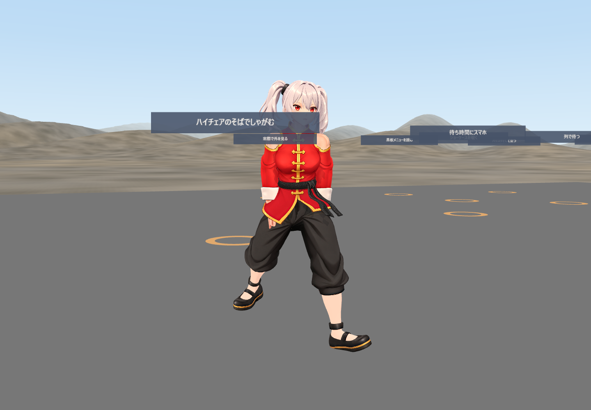
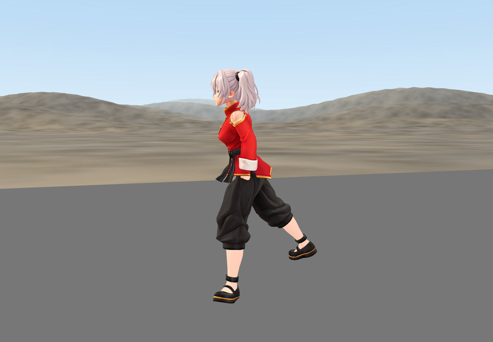
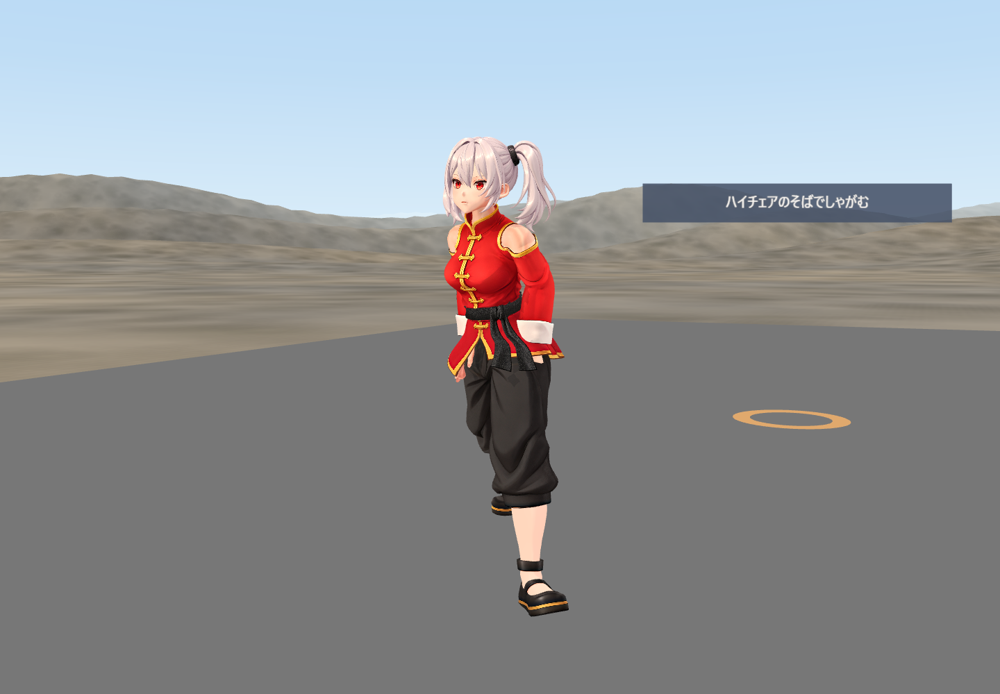

# Phase 8.1 検証記録（未完了・マージ不可）

2026-11-02。PR #5 の `feat/stop-replay-diagnostics` 上で実施。安全閾値の変更、手続き的な脚IKの追加、マージは行っていない。要求された全実動作試験の合格には至っていない。

## 再現と原因

新規GPUサーバーで比較した。修正前の50cm単独は `settled`、誤差0m。別の新規サーバーで30cm→50cmを実行すると30cmは成功、50cmは `stop_failed`、誤差7.1396cm。旧記録の23.16cmは数値まで再現していない。全受信フレームはローカルの `metrics/phase8-1-visual/baseline-sequence/` と `baseline-isolated/`、フェーズ境界の比較は `baseline-comparison.json` に保存した。

最初に観測できる分岐は、減速後の候補生成結果。単独50cmでは左支持候補が採用される。30cm直後では全候補が拒否され、STOP_RETRYを1回経て失敗する。拒否理由には支持足固定目標の到達不能、関節回転の不連続、支持足滑りが含まれる。停止予測は両方の最初の減速フレームで0m。SOMA履歴そのものを含む保存状態は `metrics/stop-replays/` に記録される。これだけで履歴内の最初の因果フレームを確定したとは扱わない。

コードで確認した不一致を修正した。

- ライブは24候補のうち6候補、補助12候補のうち2候補しか探索していなかった。全候補へ拡張した。
- 再生成CLIはライブで用いる目的地通過・逆行・前進不足の検証を行っていなかった。`stop_runtime.diagnose()` に共通化した。候補順も保存済み支持足を優先する。
- 着地回復時に目標座標だけ変更し、保存済みF001姿勢を再利用していた。現在位置に合わせて目標姿勢を再生成する。回復用の検証目的地も現在位置へ変更する。
- 撮影の `routeWebSocket().connectToServer(url)` は転送先変更として機能していなかった。観測用 `wsPort=8776` を実装した。それ以前のブラウザー試行は修正効果の証拠から除外する。

## 変更ファイル

`backend/engine.py`、`backend/locomotion_cycle.py`、`backend/stop_runtime.py`、`backend/run_stop_replay.py`、`web/src/main.js`、`web/check-phase8-visual.mjs`、`web/check-phase8-1-navigation.mjs`、`tests/test_phase81_search.py`。

## 実動作結果

旧記録は3/10到着。探索拡張と回復目標修正後、接続先を確認した新規サーバーでの1系列は5/10到着。統制された10反復比較ではないため、成功率改善の確証とは扱わない。この系列のサーバー起動後に共通診断の修正を加えたため、最終コード全体の実機合格記録でもない。

| ケース | 到着誤差cm | 結果 |
|---|---:|---|
| V01 30cm | 0.2241 | 到着 |
| V02 50cm | 16.8502 | 停止失敗 |
| V03 1m | 0 | 到着 |
| V04 2m | 0 | 到着 |
| V05 5m | 0.000048 | 到着 |
| V06 方向変更 | 13.0321 | 着地回復・未到着 |
| V07 再歩行 | 26.8373 | 着地回復・未到着 |
| V08 短距離継続 | 24.2097 | 着地回復・未到着 |
| V09 次の移動 | 13.7986 | 着地回復・未到着 |
| V10 ページ再読込 | 0.000019 | 到着 |

生結果は [visual-results.json](../metrics/phase8-1-visual/verified-server/visual-results.json)。V09は即時再移動の厳密な試験ではない。V10はブラウザー再読込のみで、バックエンド履歴をリセットしない。

## 実VRM画像・動画

カメラは描画中の腰の向きを基準に設定する。各撮影の三方向画像と関節座標は同じJavaScript呼び出し内で取得する。JSONには表示フレーム番号、補間されたSOMA姿勢、VRM関節座標、受信バックエンドフレームを区別して保存する。GroundedIdleの上半身変化はVRM関節座標に反映される。補間姿勢だけを最終VRM全身姿勢とは扱わない。

家具を非表示にし、既存クリック床の材質だけを可視化する。床の高さ、キャラクター座標、歩行制御は変更しない。V10はページ再読込により本番シーンへ戻っている。

| 50cm失敗・正面 | 側面 | 45度 |
|---|---|---|
|  |  |  |

側面画像で後足が浮いたまま固定される問題が残る。姿勢品質は不合格。足滑り、脚交差、膝角度、足幅の急変、Idle移行の跳ねのVRM連続フレーム自動判定は未完成であり、POSE_PASSとIDLE_PASSはnullを維持する。

[系列全体の録画](../metrics/phase8-1-visual/verified-server/page@363c95cce600485da5f51cb7c7b09b30.webm) には最後の一歩と停止後3秒を含む。動画全フレームと関節座標の対応づけ、連続フレームでの足滑り評価、最終歩行からIdleの目視全数評価は未完了。

## 自動テストと残件

Python 123件、JavaScript 27件成功。新規回帰テストは、除外候補の探索、回復目標の作り直し、再生成側での前進検証を扱う。構文チェックと `git diff --check` も成功。

最終コードでサーバーを再起動し、家具ありで30cm→50cmを追加撮影した。30cmは誤差0.0560cmで到着、50cmは17.0726cmで停止失敗。[本番シーンの結果](../metrics/phase8-1-visual/final-production/visual-results.json) と各方向画像・録画を同フォルダーに保存した。

50cmでは全探索後も到達不能・床貫通などで全候補拒否となる。安全基準を維持したまま、歩行停止を要求する位相、目標姿勢の到達可能性、接地状態と支持足選択の整合をさらに修正する必要がある。探索拡張による待ち時間も未解決。

初期状態リセット試験と履歴維持試験を各10回行う要求は未実施。最終コードでの保存状態再生成の完全一致確認、自然さの自動評価、即時再移動、家具あり全条件の検証も残る。今回の変更を停止失敗の根本修正完了とは報告できない。PR #5はマージ不可。
