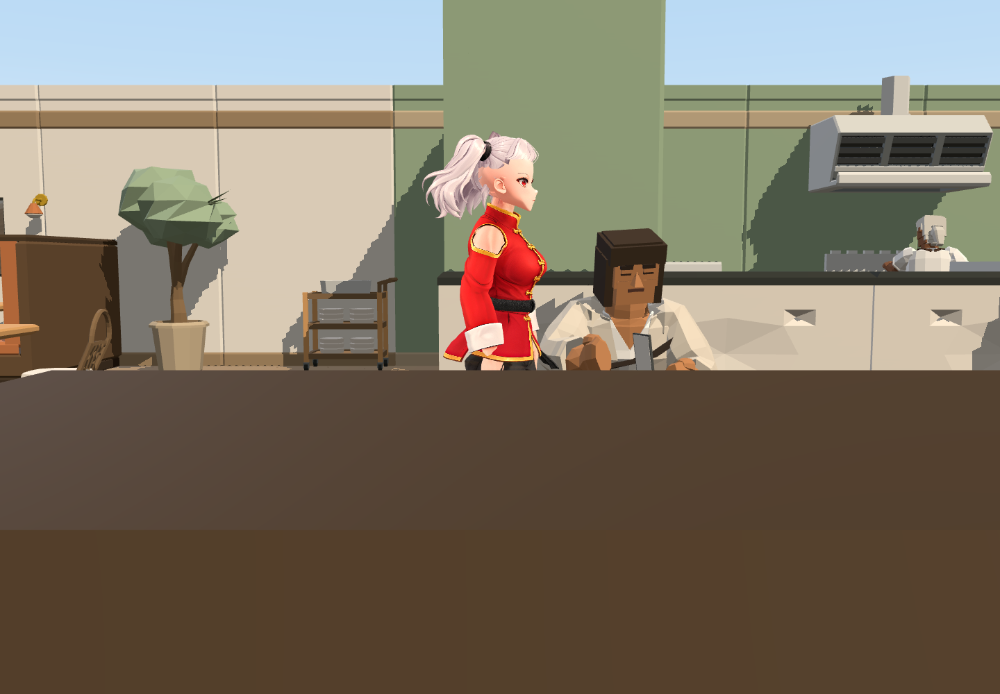
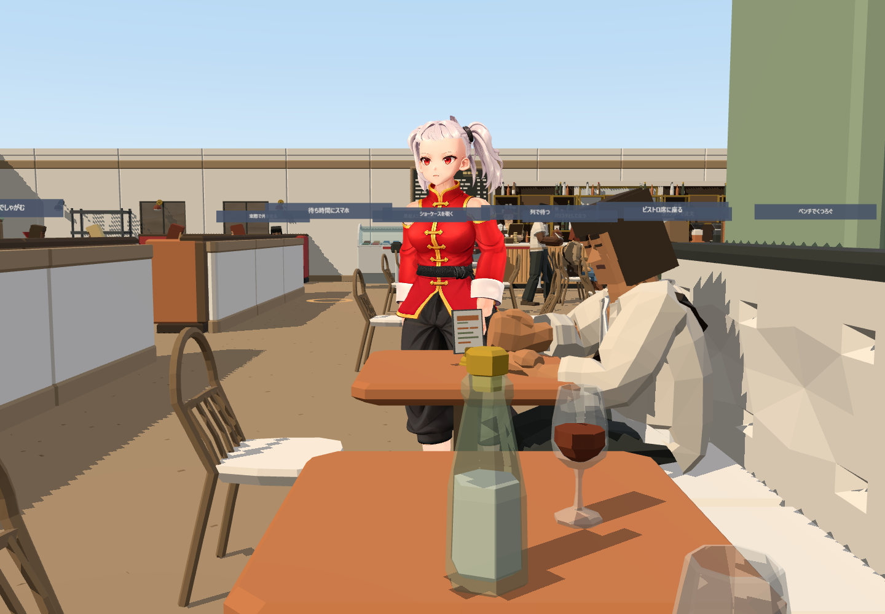
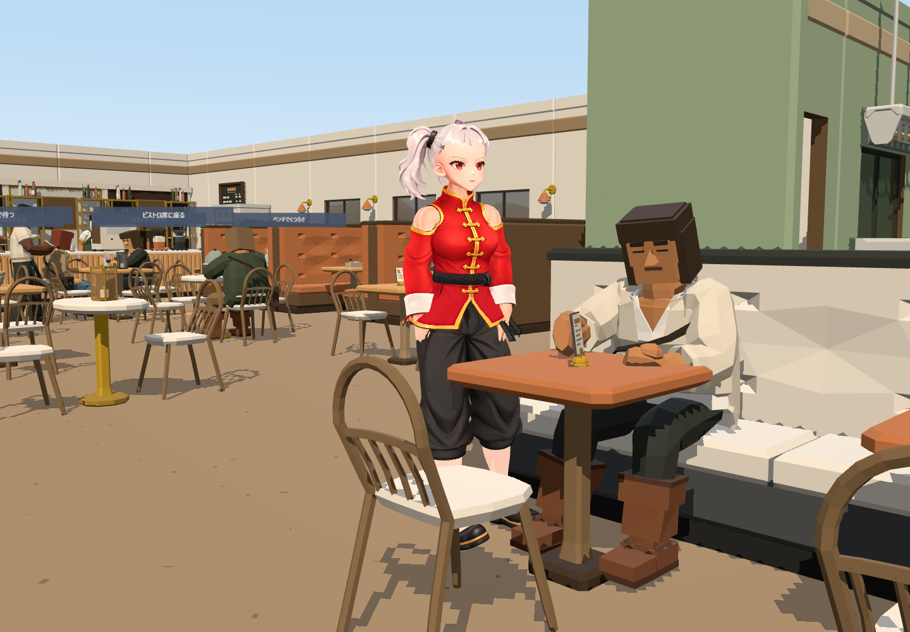
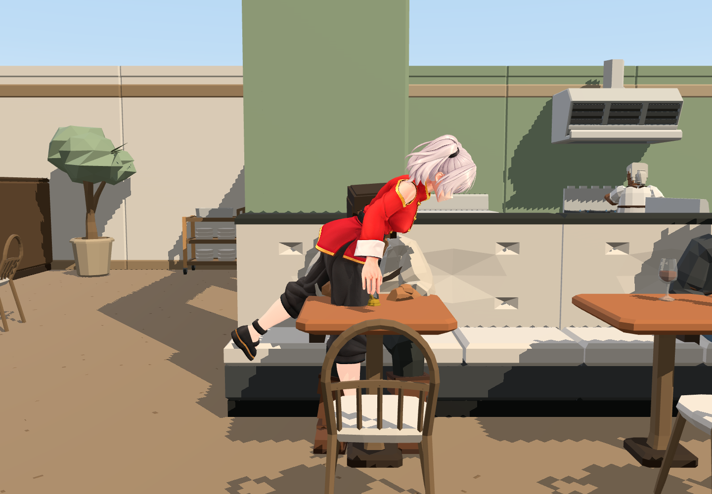
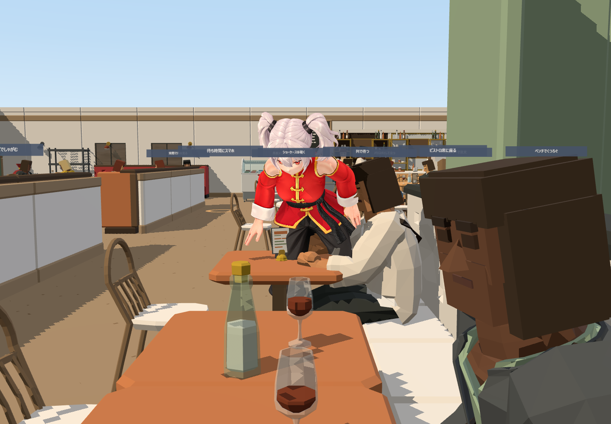
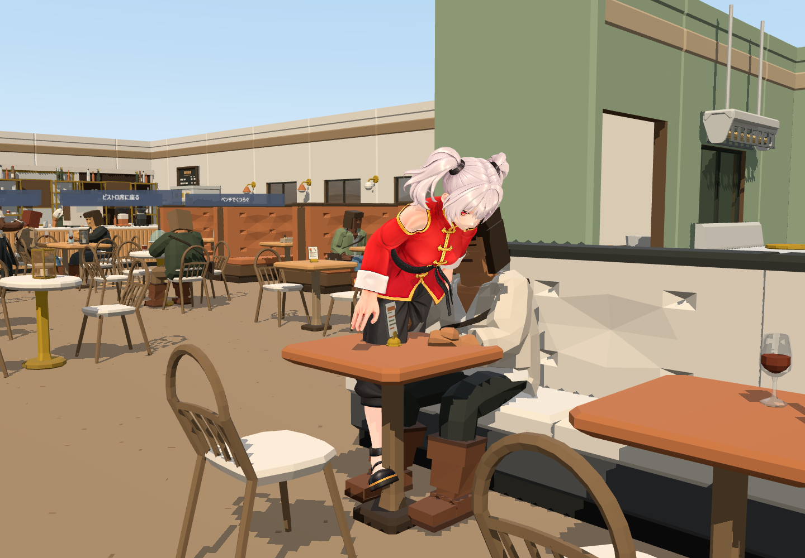

# Phase 8 検証記録（未完了・マージ不可）

2026-11-02。開始コミット `3787cee`、開始時の作業ツリーはクリーン。PR #5 の head/base が `feat/stop-replay-diagnostics` / `feat/collect-stance-step` であることを確認。main へのマージは行わない。

## 原因と修正

`LocomotionCycle.tick()` は `max(predicted, last_stop_distance_m)` を停止予測に使用していた。`begin_move()` が前回距離を消さないため、速度・向き・接地条件が異なる次の移動にも停止距離が適用される。新しい移動要求でこの値を無効化した。回帰テストは修正前に2つの subTest が失敗し、修正後に成功した。ただし、これが停止失敗の唯一の原因ではない。実歩行では安全な候補の不足が残る。

`engine.py` の保存制御状態に move_id・settle_seq・retry_count・last_stop_distance_m・向きを追加。候補探索には生成と検証の合計秒数を追加した。これらの追加は単体テスト実行後のコードに含まれるが、今回の実歩行サーバーは追加前に起動しており、新しい保存項目の実機確認は未実施。

`web/src/main.js` に `?observation` 時だけ使える観測APIを追加。描画中のVRMの関節座標と同一姿勢の三方向描画を保存する。`frame` は直近に受信したバックエンドサンプルであり、補間後のVRMと同一のSOMA時刻である保証はない。VRM関節座標は撮影呼び出し時の値。

`web/check-phase8-visual.mjs` は実際のロゼ.vrmとカフェを読み込み、表示準備完了後に10ケースを実行する。各ケースの前・移動中・停止・3秒後を撮影し、動画を保存する。POSE_PASS・IDLE_PASS は未判定を null とし、最終合格を返さない。

## 数値検証

Python全120件成功、JavaScript全27件成功。構文検査と `git diff --check` も成功。

保存状態13条件を公式GPU環境で再推論。11条件で採用候補を取得し、その11条件の再生成2回は最大差0で完全一致。直接50cm・1mの固定支持足目標は採用なし。全探索の成功をライブナビゲーション成功とは扱わない。

- 要約: `metrics/phase8-replay/summary.json`
- 全候補診断と生成配列（ローカル）: `metrics/phase8-replay/`
- 別の5操作の数値試験: `metrics/phase8-visual/stop-navigation.json`

5操作試験では20cm・50cm・再歩行がsettled、1mはstop_failed（7.27cm）、旋回はstop_failed（15.44cm）。8cm以内でもstop_failedなら到着成功とは扱わない。

## 画像と動画

10ケースは3件到着・7件停止失敗。姿勢とIdleは全件未合格。これは修正前後の統制比較ではなく、今回の履歴を維持した1系列の測定である。

| ケース | 動作 | 到着誤差cm | 状態 |
|---|---|---:|---|
| V01 | 30cm | 0.000019 | settled |
| V02 | 50cm | 23.16 | stop_failed |
| V03 | 1m | 22.69 | stop_failed |
| V04 | 2m | 6.31 | stop_failed |
| V05 | 5m | 0 | settled |
| V06 | 方向変更 | 23.73 | stop_failed |
| V07 | 再歩行 | 24.38 | stop_failed |
| V08 | 連続短距離 | 24.63 | stop_failed |
| V09 | 次の移動 | 0 | settled |
| V10 | リロード後 | 29.14 | stop_failed |

全系列の動画は `metrics/phase8-visual/page@79ae949e15579eac6bb4dd698a6ac136.webm`（約19MB、ローカル保存）。試行中の別動画も同フォルダーに存在する。再実行時は `MOTIONBRICKS_PLAYWRIGHT_PACKAGE` にインストール済みPlaywrightのpackage.json絶対パスを指定し、検証サーバー8776とWeb5188を起動して `node web/check-phase8-visual.mjs` を実行する。スクリプトは未合格のため終了コード1を返した。

`metrics/phase8-visual/` に画像、フレームJSON、動画を保存。画像を実際に開いて確認した。50cm失敗例では後方の足が浮いて身体が前傾している。家具に脚が遮られる視点もあり、初期撮影の方向名はキャラクターの向きに追従しない固定軸であるため、正面・側面の品質保証には使えない。

| 30cm停止・固定軸0度 | 固定軸90度 | 固定軸45度 |
|---|---|---|
|  |  |  |

| 50cm失敗・固定軸0度 | 固定軸90度 | 固定軸45度 |
|---|---|---|
|  |  |  |

画像だけで足滑りを合格にしていない。動画の全フレーム評価も未完了。

## 公式実装との照合

ローカル公式 `app/runtime/common/character.py:234` の `generate_to_target_poses()` を確認した。指定されたpinは最初の目標姿勢から取得される。アプリは公式APIを使用しているが、内部の `_target_pose_ik_corrector` と `_sample_playback` にも依存する。公式呼び出しを使うこと自体は自然な着地を保証せず、この統合全体が適切という結論には至っていない。

## 性能

13条件の全探索は約0.34〜12.36秒。GPUとブラウザが並行動作した測定であり、単独の推論性能ではない。生成時間・検証時間の分離、画面反映待ち時間の厳密な計測は未実装。

## 未達項目

停止成功率の安定化、安全な短距離候補の改善、失敗からの着地回復、VRMの脚交差・靴底メッシュ接触の判定、1秒の姿勢安定計測、上半身傾き、Idleと再歩行の連続性評価は未完了。GroundedIdleの動作と既存の安全閾値は変更していない。新規の手続き的脚IKは追加していない。

10ケースの一連操作と、要求された10回の連続試験は異なる。完全リセット/履歴維持それぞれ10回の反復、停止直後の即時再移動、厳密な90度旋回、最後の一歩の全撮影タイミング、平行投影、接地軌跡の表示は未達。三つのPASSを満たした最終成功例はまだ報告できない。
